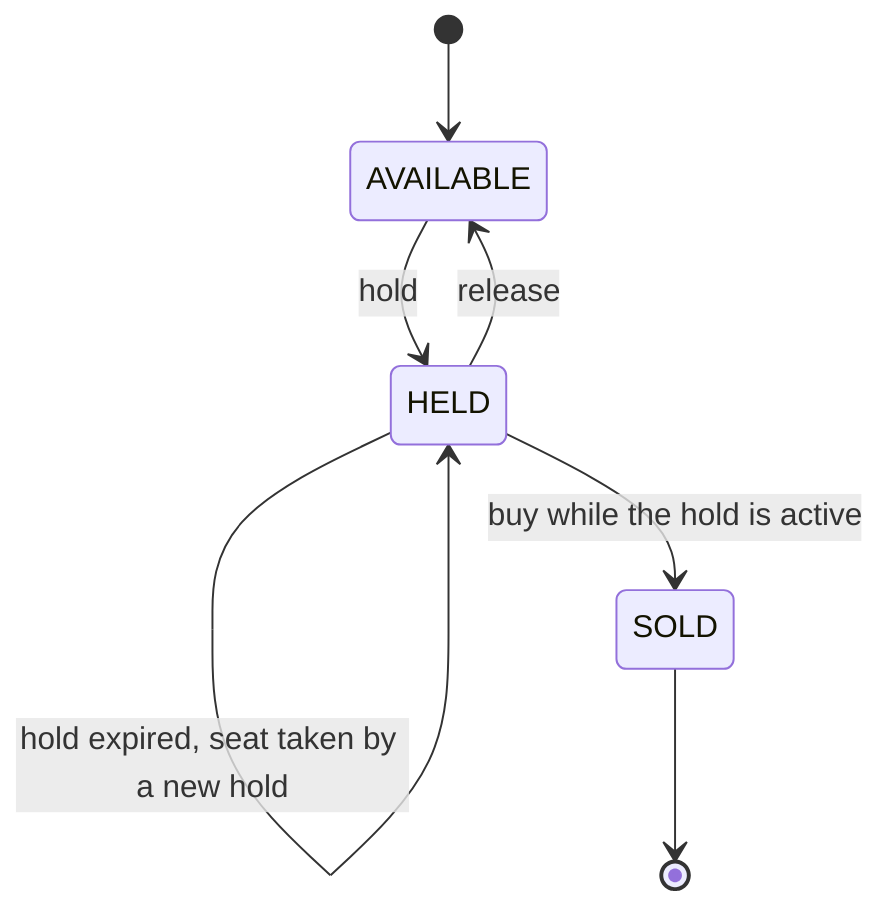

# Booking Core: Design Spec

| | |
|---|---|
| Project | TicketDrop (working title) |
| Piece | 1 of 3: booking core |
| Date | 2026-11-11 |
| Status | Approved |

## 1. Context

TicketDrop is a portfolio project: an event-ticketing system built to show one thing convincingly, that it never sells the same seat twice, even when many buyers go for it at the same moment. The audience is recruiters and interviewers for junior backend and full-stack roles, so the repository has to carry its own evidence: tests that prove the claim, load-test numbers, and a written account of the decisions.

The project is built in three pieces over roughly 4-6 weeks:

1. **Booking core (this spec).** The API and database that hold and sell seats, with the tests and load test that prove correctness.
2. **Live seat map.** A React page where seats change state in real time, deployed at a public link.
3. **Write-up.** The README: results, what broke and how it was fixed, an architecture diagram and a demo.

Each piece gets its own spec and plan. A waiting room, dashboards, an Android client and Redis-backed holds are deliberately left for later.

The booking logic is the part interviewers will ask about, so the build order (section 11) puts everything else in place first and leaves it for last.

## 2. Goal and success criteria

**Goal:** a service that lets buyers hold and buy seats, and that can demonstrate on demand that no seat is ever sold twice.

The piece is done when all of these are true:

1. `docker compose up` starts the service and its database, and the API behaves as described in section 7.
2. The API tests and race tests (section 10) pass in CI on every push.
3. One documented command runs the race tests against the naive strategy and shows them failing, with more than one winner for the same seat.
4. A full load-test run finishes with no HTTP 500 responses and a passing verification step, and its numbers are recorded in the README.
5. You can answer the questions in section 14 without looking at the code.

## 3. Scope

**In scope**

- Create an event with a rectangular block of seats.
- List an event's seats with their current status, plus a summary count.
- Hold 1-4 seats for a limited time, all or nothing.
- Release a hold.
- Buy the seats of a hold. Buying the same hold again returns the same order.
- Hold expiry without a background job.
- A deliberately unsafe "naive" strategy alongside the safe one, for demonstration.
- API tests, race tests, a load test with a verification step, Docker Compose and CI.

**Out of scope for this piece**

- Logins and user accounts. A buyer is just an ID the client sends.
- Payments. Buying is a single request with no payment step.
- Any user interface, live updates and public deployment (piece 2).
- A waiting room, rate limiting and per-buyer limits.
- Redis, message queues, and running more than one copy of the service.
- Cleaning up old hold records.

## 4. Technology

| Concern | Choice |
|---|---|
| Language | Java 25 (current long-term-support release) |
| Framework | Spring Boot 4.1.x (4.1.2 is current at the time of writing): Web MVC, JDBC, Validation, Flyway, Actuator (health endpoint only) |
| Database | PostgreSQL 18 |
| Database access | Plain SQL through Spring's `JdbcClient` |
| Schema changes | Flyway migrations |
| Build | Maven, through the Maven wrapper |
| Tests | JUnit and AssertJ (versions managed by Spring Boot), Testcontainers running PostgreSQL 18 |
| Load test | k6, run from its Docker image |
| Local environment | Docker Compose |
| CI | GitHub Actions |

Reasons for the choices that are not obvious:

- **Plain SQL instead of JPA.** The statements that make booking safe are the point of the project, so they should be visible in the code and easy to explain. JPA's usual load-change-save pattern is exactly the bug the naive strategy demonstrates.
- **Tests against a real PostgreSQL.** Locking behaviour differs between databases, so an in-memory substitute would prove nothing.
- **Java 25 although the development machine has JDK 27.** 25 is the long-term-support release that employers run. The build compiles for 25 and works on any JDK from 25 up. CI and the Docker image use 25 exactly.
- **Maven.** Its wrapper needs nothing installed, and it copes well with a newer local JDK. Gradle is equally valid; if your coursework uses it and you would rather stay with it, say so in review.

## 5. Data model

Four tables. `seats` is the only one whose rows change after they are created.

### `events`

| Column | Type | Notes |
|---|---|---|
| `id` | bigint, identity | Primary key |
| `name` | text | Not null |
| `row_count` | integer | Not null, 1-100 |
| `seats_per_row` | integer | Not null, 1-100 |
| `created_at` | timestamptz | Not null, defaults to now |

### `holds`

One row per successful hold. Never updated or deleted in this piece.

| Column | Type | Notes |
|---|---|---|
| `id` | uuid | Primary key. Random, generated by the service |
| `event_id` | bigint | Not null, references `events` |
| `buyer_id` | uuid | Not null |
| `seat_count` | integer | Not null, at least 1. How many seats the hold took |
| `expires_at` | timestamptz | Not null |
| `created_at` | timestamptz | Not null, defaults to now |

### `orders`

| Column | Type | Notes |
|---|---|---|
| `id` | uuid | Primary key. Random, generated by the service |
| `event_id` | bigint | Not null, references `events` |
| `buyer_id` | uuid | Not null. Copied from the hold |
| `hold_id` | uuid | Not null, references `holds`, **unique** |
| `created_at` | timestamptz | Not null, defaults to now |

The unique constraint on `hold_id` means a hold can produce at most one order, whatever the application code does.

### `seats`

| Column | Type | Notes |
|---|---|---|
| `id` | bigint, identity | Primary key |
| `event_id` | bigint | Not null, references `events` |
| `row_no` | integer | Not null, counted from 1 |
| `seat_no` | integer | Not null, counted from 1 within the row |
| `status` | text | Not null. One of `AVAILABLE`, `HELD`, `SOLD`. Defaults to `AVAILABLE` |
| `hold_id` | uuid | References `holds`. Set only while `HELD` |
| `hold_expires_at` | timestamptz | A copy of the hold's `expires_at`. Set only while `HELD` |
| `order_id` | uuid | References `orders`. Set only when `SOLD` |

Constraints and indexes:

- Unique on (`event_id`, `row_no`, `seat_no`).
- A check constraint ties the other columns to the status, so an impossible combination cannot be stored:
  - `AVAILABLE`: `hold_id`, `hold_expires_at` and `order_id` are all null.
  - `HELD`: `hold_id` and `hold_expires_at` are set, `order_id` is null.
  - `SOLD`: `order_id` is set, `hold_id` and `hold_expires_at` are null.
- Indexes on `hold_id` and on `order_id`, each covering only the rows where the column is set.

The expiry time is copied onto each seat row so that "is this seat free?" can be answered, and acted on, from the seat row alone.

## 6. Seat lifecycle and rules

### Definitions

- **Database time:** PostgreSQL's `now()`, which is the time the current transaction started. Every expiry decision uses it. The application's own clock is never consulted.
- **Free seat:** a seat whose status is `AVAILABLE`, or whose status is `HELD` with `hold_expires_at` at or before database time.
- **Actively held seat:** a seat whose status is `HELD` with `hold_expires_at` after database time.
- **Effective status:** what the API reports for a seat: `AVAILABLE` if it is free, `HELD` if it is actively held, `SOLD` if it is sold.

### States



`SOLD` is final. Nothing in this piece changes a sold seat.

### Hold

Input: an event, a buyer ID and 1-4 distinct seat IDs. The upper limit is a setting (section 12).

1. Invalid input is rejected (400). An unknown event is rejected (404). Seat IDs that do not belong to the event are rejected (404). These checks happen in that order.
2. In one transaction, the requested seats are locked in ascending ID order. If every one of them is free, a hold record is created (new random ID, the buyer, the seat count, expiry = database time + the hold duration) and each seat becomes `HELD` with that hold's ID and expiry.
3. If any requested seat is not free, nothing changes, and the response is 409 listing the seats that were not free.

A seat the same buyer already holds is not free. There is no re-hold and no extension. To change a selection, the buyer releases and holds again.

### Release

Input: a hold ID.

In one transaction, the seats that still carry this hold's ID and are `HELD` are locked in ascending ID order and become `AVAILABLE`, with their hold columns cleared. Seats that have been sold, or that another hold has since taken, are untouched. The response is always 204, including when the hold is unknown, expired, already released or already bought.

### Buy

Input: a hold ID.

In one transaction:

1. The seats that carry this hold's ID and are actively held are locked in ascending ID order.
2. If the number of locked seats equals the hold's `seat_count`, an order is created (new random ID, the hold's event and buyer, the hold ID) and those seats become `SOLD` with the order's ID, their hold columns cleared. The response is 201 with the order.
3. Otherwise nothing is sold. If an order already exists for this hold, the response is 200 with that order. If the hold does not exist, the response is 404. In every other case the response is 410: the hold has expired or been released.

Step 2 compares counts, not just "at least one seat", because of a race at the moment of expiry. A purchase that starts just before the hold expires can overlap with another buyer taking one of its seats just after. Without the count check, the purchase would sell the seats it still has and silently drop the one it lost. With it, a hold is bought whole or not at all.

Step 3 makes buying idempotent. If the client's first request succeeded but the response was lost, the retry gets the same order back instead of an error or a second order.

### Expiry

There is no background job. A hold that has expired is simply treated as free by every rule above, and its seats keep their old `HELD` row contents until the next hold or release overwrites them. Nothing has to run on time, so nothing can fall behind.

### Concurrency requirements

These apply to the safe strategy. They are what the race tests check.

- **One transaction per operation**, at PostgreSQL's default isolation level (READ COMMITTED).
- **No decision on stale data.** Every change to a seat is made only after the seat's row has been locked in the same transaction, or by a single statement whose condition re-checks the state it depends on.
- **One locking order.** Any operation that touches more than one seat locks them in ascending ID order. This is what prevents deadlocks.
- **Database time only**, as defined above.
- **No state in memory.** Everything that matters is in the database, so the design stays correct if more copies of the service are added later.

## 7. API

All requests and responses are JSON. IDs of events and seats are integers. IDs of buyers, holds and orders are UUID strings. Timestamps are ISO-8601 in UTC, for example `2026-11-11T18:35:00Z`.

### Error format

```json
{ "error": "SEATS_UNAVAILABLE", "message": "Seats 102 are no longer available.", "unavailableSeatIds": [102] }
```

`error` is a stable code, `message` is for humans, and some errors add fields of their own.

| Status | Code | When |
|---|---|---|
| 400 | `VALIDATION_FAILED` | Missing or malformed input |
| 404 | `EVENT_NOT_FOUND` | No event with that ID |
| 404 | `SEAT_NOT_FOUND` | A seat ID is not part of the event. Adds `unknownSeatIds` |
| 404 | `HOLD_NOT_FOUND` | Buying a hold ID that never existed |
| 409 | `SEATS_UNAVAILABLE` | At least one requested seat is not free. Adds `unavailableSeatIds` |
| 410 | `HOLD_NOT_ACTIVE` | Buying a hold that has expired or been released |
| 503 | `TRY_AGAIN` | The database reported a deadlock or lock timeout |
| 500 | `INTERNAL_ERROR` | Anything unexpected. No internal details in the body |

### `POST /api/events`

Creates an event and all of its seats in one transaction.

```json
{ "name": "Launch Night", "rows": 20, "seatsPerRow": 25 }
```

- `name`: required, 1-100 characters. `rows` and `seatsPerRow`: required, 1-100 each.
- **201:**

```json
{ "id": 1, "name": "Launch Night", "rows": 20, "seatsPerRow": 25, "seatCount": 500 }
```

- **400** `VALIDATION_FAILED`.

### `GET /api/events/{eventId}/seats`

- **200:** every seat of the event, ordered by row then number, with its effective status.

```json
[
  { "id": 101, "row": 1, "number": 1, "status": "AVAILABLE" },
  { "id": 102, "row": 1, "number": 2, "status": "HELD" }
]
```

- **404** `EVENT_NOT_FOUND`.

### `GET /api/events/{eventId}/summary`

- **200:** counts by effective status, plus the number of orders.

```json
{ "eventId": 1, "seatCount": 500, "available": 480, "held": 8, "sold": 12, "orders": 5 }
```

- **404** `EVENT_NOT_FOUND`.

### `POST /api/events/{eventId}/holds`

```json
{ "buyerId": "6f1c2a9e-3b7d-4c55-9a40-0d2f8e1b7c11", "seatIds": [101, 102] }
```

- `buyerId`: required UUID. `seatIds`: required, 1-4 integers, no duplicates.
- **201:**

```json
{
  "holdId": "b3e1f0a2-58c4-4d0e-8f6a-2c9d7e4b1a30",
  "eventId": 1,
  "buyerId": "6f1c2a9e-3b7d-4c55-9a40-0d2f8e1b7c11",
  "seatIds": [101, 102],
  "expiresAt": "2026-11-11T18:35:00Z"
}
```

- **400** `VALIDATION_FAILED`, **404** `EVENT_NOT_FOUND`, **404** `SEAT_NOT_FOUND`, **409** `SEATS_UNAVAILABLE`.

### `DELETE /api/holds/{holdId}`

- **204** always, as described under Release.
- **400** `VALIDATION_FAILED` if `holdId` is not a UUID.

### `POST /api/orders`

```json
{ "holdId": "b3e1f0a2-58c4-4d0e-8f6a-2c9d7e4b1a30" }
```

- **201** the first time, **200** on a repeat, with the same body both times:

```json
{
  "orderId": "0a7d5c1e-9f42-4b8a-b1d3-6e2c4f8a9b07",
  "eventId": 1,
  "buyerId": "6f1c2a9e-3b7d-4c55-9a40-0d2f8e1b7c11",
  "holdId": "b3e1f0a2-58c4-4d0e-8f6a-2c9d7e4b1a30",
  "seatIds": [101, 102],
  "createdAt": "2026-11-11T18:31:12Z"
}
```

- **400** `VALIDATION_FAILED`, **404** `HOLD_NOT_FOUND`, **410** `HOLD_NOT_ACTIVE`.

## 8. Components

One Spring Boot service, split into units with one job each.

| Unit | Responsibility | Depends on |
|---|---|---|
| Event endpoints | HTTP for creating events, listing seats and the summary | `EventService` |
| Hold and order endpoints | HTTP for hold, release and buy: input validation, and mapping results to status codes | `BookingService` |
| Error handler | Turns failures into the error format of section 7 | Nothing |
| `EventService` | Creates events and their seats. Reads seats and summaries using effective status | Database |
| `BookingService` | An interface with three operations: `hold`, `release`, `buy` | Nothing |
| `AtomicBookingService` | The safe implementation. The default | Database |
| `NaiveBookingService` | The unsafe baseline (section 9) | Database |
| Migrations | Create the schema of section 5 | Database |

The endpoints know nothing about locking, and the booking implementations know nothing about HTTP. That boundary is what lets the same tests and the same load test run against either strategy.

## 9. The two strategies

Both implement `BookingService`. A configuration setting picks one at startup (section 12).

- **Atomic (default).** Follows every rule in section 6.
- **Naive.** For each operation it reads the rows it needs, decides in Java, then writes, with no locks and no conditions on the writes. It gives correct answers when requests arrive one at a time, so it passes the API tests. It gives wrong answers when they overlap, so it fails the race tests.

The naive strategy stays in the repository on purpose. It lets anyone who clones the project reproduce the bug with one command, and it gives the README a measured before-and-after. It is never the default, and the service logs a warning at startup when it is enabled.

You write the naive strategy first, watch the race tests fail against it, then write the atomic one.

## 10. Testing and proof

### API tests

Run the real service against a real PostgreSQL and call it over HTTP. They cover every endpoint, status code and rule in sections 6 and 7 one request at a time, including: a hold that conflicts, a multi-seat hold where one seat is taken and none end up held, taking over an expired hold, buying after expiry, buying twice, releasing after a sale. Expiry is simulated by setting a hold's expiry into the past with SQL, so no test has to wait.

These tests pass against both strategies.

### Race tests

Each fires many requests at the running service at the same instant. R1-R4 run 20 rounds each, on fresh seats every round. A round that has not finished within 30 seconds fails the test.

| ID | Scenario | Passes when |
|---|---|---|
| R1 | 200 buyers request the same single seat | Exactly one gets 201. The rest get 409 |
| R2 | 200 buyers each request a random 2-4 seats from the same block of 10, with the IDs in random order | Only 201 and 409 occur. No seat appears in two 201 responses. Afterwards, the seats of each 201 response are held under that response's hold ID, and no other seat is held |
| R3 | The same hold is bought by 50 callers | Exactly one gets 201 and the rest get 200, all with the same order ID. One order row exists |
| R4 | A 3-seat hold is set to expire a few milliseconds ahead. Its buyer buys while 30 other buyers each try to hold one of its seats | Either the buy returns 201 and all three seats are sold to that order, or it returns 410 and none are. Never one or two |
| R5 | Storm, run once: on a 50-seat event, 200 buyers repeat "hold 1-4 random seats, then buy (80%) or release (20%)" until the event is sold out | All 50 seats end up sold. No 5xx response occurs. The invariant checks below pass, including the accounting and kept-promise checks |

The race tests read the strategy from configuration, so the same tests run against both. CI runs them against the atomic strategy, where they must pass every time.

### Invariant checks

SQL queries that must find nothing wrong. They run at the end of every race test and after every load test.

- **V1.** Every seat's columns agree with its status. (Also enforced by the check constraint.)
- **V2.** Every order has exactly as many `SOLD` seats pointing at it as its hold's `seat_count`.
- **V3.** Every `SOLD` seat points at an order for the same event.
- **V4.** No hold has more than one order. (Also enforced by the unique constraint.)
- **V5, accounting.** The number of seats in 201 responses to buy equals the number of `SOLD` seats, and the number of those responses equals the number of orders. This applies where the test counts its own responses: R5 and the load test. It is the check that catches two buyers both being told they bought the same seat.
- **V6, kept promises.** No buy request made within the hold duration of its own hold is answered 410. A buyer who was told "these seats are yours for five minutes" and buys in time must get them. This applies where buyers always buy within seconds of holding: R5 and the load test. It is the check that catches two buyers both being told they hold the same seat, which is how the naive strategy fails most often.

### Load test

A simulated drop, run locally with one command that starts the database and the service in Docker Compose, runs k6, then runs the verification step.

- **Fixed container limits**, so runs are comparable: 2 CPUs and 1 GB of memory for the service, and the same for the database.
- **Scenario.** Setup creates a fresh event, 20 rows of 25 seats by default. 2,000 virtual buyers start within 10 seconds. Each buyer lists the seats, picks 1-4 that show as available, and tries to hold them, picking again on a 409 up to 5 times. A buyer with a hold waits 1-3 seconds, then buys (90%) or releases (10%). The run ends when every buyer has finished, or after 2 minutes.
- **Parameters.** The number of buyers and the event's size are environment variables, so the run can be scaled to the machine.
- **Expected responses.** A 409 on hold is a normal outcome and is not counted as a failure. A 410 on buy is not normal here: every buyer buys within seconds of holding, so a 410 means the service gave the same seat to two buyers. The run counts these for V6.
- **Verification.** V1-V6 must pass, with k6 supplying the response counts for V5 and V6.
- **Gate.** A run is good if verification passes and no response had status 500. Performance numbers are recorded, not gated.
- **Recorded for the README:** total requests, peak requests per second, 95th and 99th percentile response times for hold and for buy, time from the first hold to the last order, the share of hold requests answered 409, and the machine's CPU and memory alongside the container limits.

The same run against the naive strategy is expected to fail verification, mainly on V6. Both results go in the README side by side, including how many promises the naive run broke.

Tuning follows one rule: start from the defaults (connection pool, server threads), change one thing at a time in response to a measurement, and record the before and after.

### CI

A GitHub Actions workflow runs on every push and pull request: JDK 25, then the full build with the API tests and race tests. The load test is not part of CI.

## 11. Build order

The pieces are built in this order, so that every step has something to run against:

1. Project skeleton, Maven setup and schema migrations.
2. Event endpoints and `EventService`, and the error handler.
3. The `BookingService` interface, the hold and order endpoints, and their API tests, written from this spec before the logic exists.
4. Test setup: Testcontainers, a helper for firing concurrent requests, and the invariant queries.
5. `NaiveBookingService`.
6. Race tests R1-R5.
7. `AtomicBookingService`: hold, release, buy and their SQL.
8. Dockerfile, Docker Compose and the CI workflow, then the k6 script and the verification step.
9. Running the load test, tuning, and recording the results.

Every change is reviewed before it lands on `main`, which always builds and passes its tests.

## 12. Configuration

| Setting | Default | Meaning |
|---|---|---|
| `ticketdrop.hold-duration` | `5m` | How long a hold lasts |
| `ticketdrop.max-seats-per-hold` | `4` | The most seats one hold may take |
| `ticketdrop.booking-strategy` | `atomic` | `atomic` or `naive` |

## 13. Risks and notes

- **JDK 27 locally, Java 25 as the target.** If any build tooling does not yet run on JDK 27, the fix is to install JDK 25 next to it. Nothing in the design changes.
- **Docker must be running** for the tests (Testcontainers) and the load test.
- **The API is open.** With no logins, anyone who can reach the service can create events and buy seats. That is acceptable on a laptop and must be dealt with before the public deployment in piece 2.
- **Hold records accumulate.** One row per successful hold, never cleaned up. Harmless at this scale and noted for later.
- **Laptop numbers are indicative.** The README states the hardware and the container limits next to every figure.

## 14. What you should be able to explain afterwards

1. Why does the naive strategy sell a seat twice? Walk through two overlapping requests step by step.
2. Why is one conditional update safe when two transactions run it at the same moment? What does PostgreSQL do with the second one?
3. Why is the default isolation level enough here?
4. Why are seats locked in ascending ID order, and what happens without that?
5. Why does buy compare the number of seats it locked with the hold's seat count?
6. How does buying the same hold twice return the same order, and what would go wrong without that?
7. Why does expiry need no background job, and what does that choice cost?
8. Why does all timing use the database clock?
9. Where does this design stop scaling, and what would you change first?
